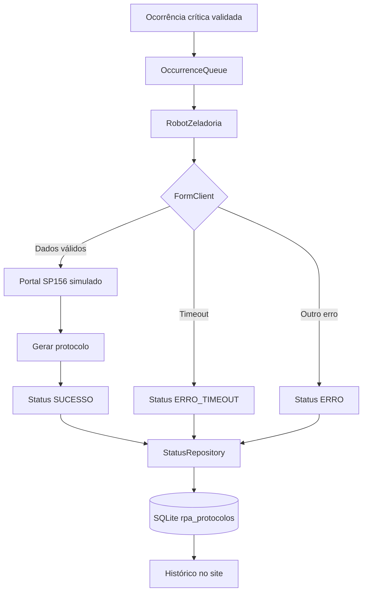

# Fluxograma do RPA

O fluxo começa com uma ocorrência crítica já validada pelo MVP e termina com o
registro do resultado no SQLite e no histórico da interface.

## Pontos principais

1. A fila fornece somente ocorrências validadas.
2. O `RobotZeladoria` coordena o processamento.
3. O cliente do formulário valida os campos e simula o portal.
4. Todo resultado, inclusive falhas, é persistido.
5. A interface consulta o histórico pela rota `/api/history`.
